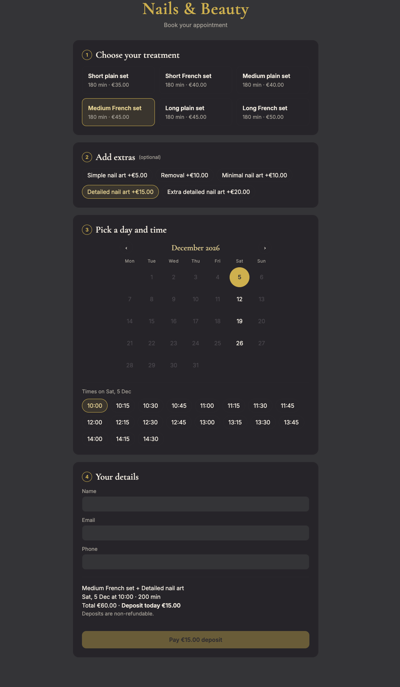
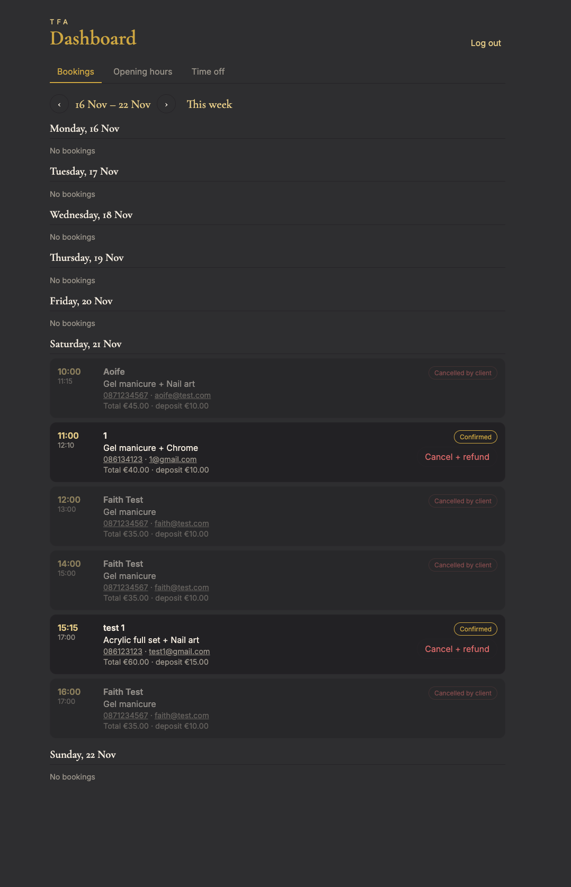
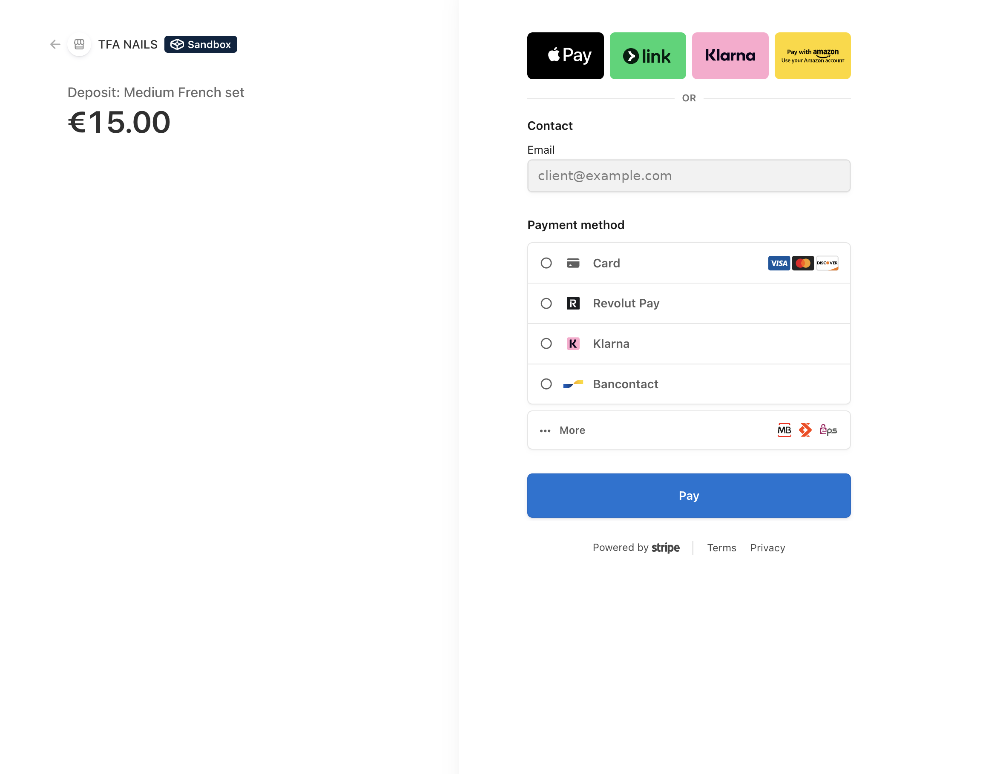

# TFA Booking

A booking and payments system for my nail business, [TFA Nails & Beauty](https://www.instagram.com/tfa.nailsandbeauty/). Clients pick a treatment, choose a time on a calendar, and pay a €15 deposit with Stripe. I manage bookings, hours and days off from an admin dashboard.

**Live demo:** https://tfa-booking-site.onrender.com (Stripe test mode, so use card `4242 4242 4242 4242`)
**API docs:** https://tfa-booking-api.onrender.com/docs

> Hosted on free tiers, so the first load can take about 30 seconds while the server wakes up.



## Why I built it

I used Calendly and Square Appointments. Calendly had a smooth booking flow but no branding. Square had a branded site, but setting availability was awkward. Neither let me set my own deposit rules. So I built one system that does what my business actually needs.

## Features

- **Calendar booking.** Pick a day, then see only the times that are actually free.
- **Stripe deposits.** A flat €15 deposit is taken through Stripe Checkout and confirmed by webhook.
- **No double bookings.** A PostgreSQL exclusion constraint makes overlapping bookings impossible, even if two clients click at the same moment.
- **My cancellation rules.** If a client cancels or doesn't show, I keep the deposit. If I cancel, the deposit is refunded automatically through Stripe.
- **Admin dashboard.** View bookings, mark no-shows or completed, cancel with refund, set weekly hours and block days off.
- **Add-ons.** Removal and four levels of nail art, each adding time and price.



## How a booking works

```
Client picks slot ──► POST /bookings          (booking saved as "pending", slot held)
                  ──► POST /bookings/{id}/checkout ──► Stripe Checkout page
Client pays       ──► Stripe sends webhook ──► POST /webhooks/stripe
                                              (signature checked, booking → "confirmed")
Client abandons   ──► session expires after 31 min ──► booking → "cancelled", slot freed
```



## Tech stack

| Layer | Technology |
| --- | --- |
| Backend | Python, FastAPI, SQLAlchemy 2.0, Pydantic |
| Database | PostgreSQL (Neon), Alembic migrations |
| Payments | Stripe Checkout, webhooks, refunds |
| Frontend | React (JavaScript), Vite |
| Hosting | Render (infrastructure as code with `render.yaml`) |
| CI | GitHub Actions runs the tests on every pull request |

## Design decisions

| Decision | Why |
| --- | --- |
| Money stored as integer cents | Floats round badly (0.1 + 0.2 ≠ 0.3). Stripe also uses cents. |
| Database exclusion constraint for overlaps | The database is the last line of defence. Checking in code alone can miss two requests that arrive at the same time. |
| Bookings are confirmed by webhook, not by the success page | A client can close the tab after paying. The webhook always arrives, and it's signed, so it can't be faked. |
| Stripe event IDs stored | Stripe can send the same event twice. Saving each ID means it's only processed once (idempotency). |
| Refunds use an idempotency key | Clicking "cancel" twice can never refund twice. |
| Price copied onto each booking | If I change a price later, old bookings keep the price the client agreed to. |
| Secret `manage_token` on each booking | Stops someone cancelling another person's booking just by guessing its ID. |
| Old services hidden, not deleted | Past bookings still point at them, so deleting would break history. |
| Slot finder is a pure function | No database or network needed, so it's quick and easy to unit test. |

## Running it locally

**Backend**
```bash
cp .env.example .env          # then fill in your own values
cd backend
python3 -m venv .venv
source .venv/bin/activate
pip install -r requirements-dev.txt
alembic upgrade head          # create the tables
python load_menu.py           # add the menu
uvicorn app.main:app --reload
```

**Stripe webhooks (separate terminal)**
```bash
stripe listen --forward-to localhost:8000/webhooks/stripe \
  --events checkout.session.completed,checkout.session.expired
```

**Frontend (separate terminal)**
```bash
cd frontend
npm install
npm run dev
```
Then open http://localhost:5173.

## Tests

```bash
cd backend
pytest -v
```
Covers the slot finder (opening hours, existing bookings, buffers, past times, time off) and the deposit rule.

## Project structure

```
tfa-booking/
├── backend/
│   ├── app/
│   │   ├── main.py          public API (services, availability, bookings, webhook)
│   │   ├── admin.py         admin API (protected by an API key)
│   │   ├── availability.py  finds free slots
│   │   ├── payments.py      all Stripe calls
│   │   ├── pricing.py       deposit rule
│   │   └── models.py        database tables
│   ├── migrations/          Alembic database migrations
│   ├── tests/
│   └── load_menu.py         loads the real menu
├── frontend/src/            React booking page, calendar and admin dashboard
├── render.yaml              hosting setup
└── .github/workflows/       CI
```

## What I'd add next

- Email confirmations and reminders
- Clients rescheduling their own bookings
- Saving a client's card for future deposits
- Switching Stripe to live mode
